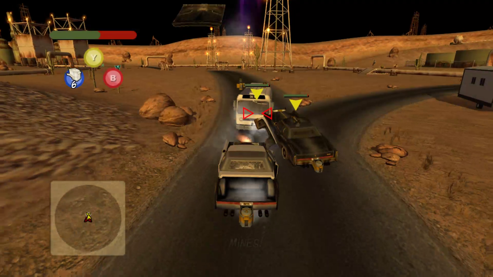
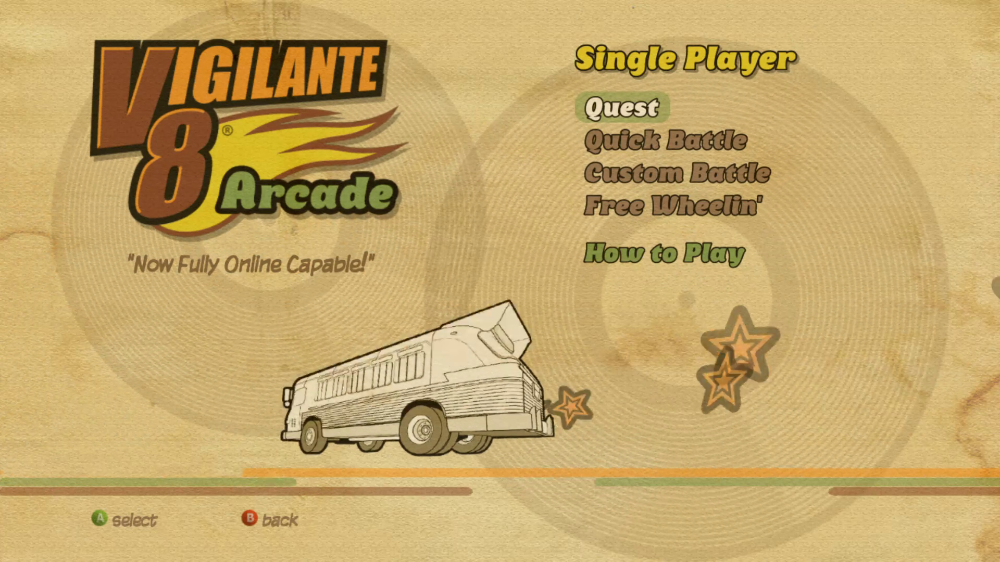
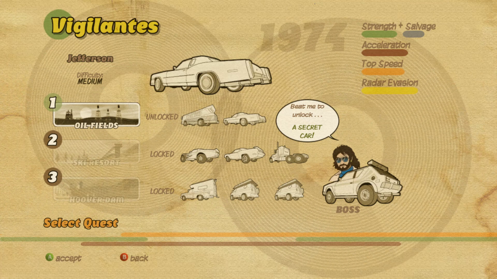
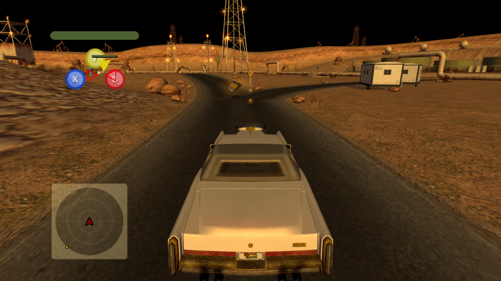

# Vigilante 8 Arcade (Xbox 360, 2008) — Static Recompilation

Vigilante 8 Arcade's Xbox 360 executable, recompiled from PowerPC to native x86-64 C++ with the
[ReXGlue SDK](https://github.com/rexglue/rexglue-sdk), so it runs on Windows without an emulator.
The XBLA game never had a PC release.



## Status

**v0.1.0, alpha.** Single player works: boot, menus, Quest, and full battles with correct graphics,
audio and controller input, on ReXGlue 0.10. Multiplayer is written but not yet tested on this
SDK.

| Feature | State |
| --- | --- |
| Boot, Activision logo, menus | works |
| Single player: Quest into a battle on Oil Fields | works |
| Other modes and levels | expected to work (they did on the 0.1 build); not re-tested on 0.10 |
| Local split-screen (`--signed_in_players=2`..`4`) | worked on the 0.1 build; not re-tested |
| System Link (LAN) and internet play via an [xlive](https://github.com/sp00nznet/xlive) relay | the relay found a hosted session on the 0.1 build, then crashed; not tested on 0.10 ([details](docs/networking.md#what-has-been-tested)) |
| Startup | about 90 s before the window appears on the test machine ([ROADMAP](ROADMAP.md)) |

This repository holds no game code or data. The C++ is generated on your machine from your own copy
of the game and is never committed or published, and neither is a build of it (see
[License](#license)).

## Screenshots

From the recompiled build, 2026-10-20.





## Getting Started

You need your own copy of Vigilante 8 Arcade (title ID `584108A8`): the XBLA package copied off an
Xbox 360 hard drive or USB stick (a file with a 40-character hex name, under
`Content\0000000000000000\584108A8\000D0000\`), or a folder you already extracted it to that
contains `default.xex`.

### Quick start

**Installer:** download `Vig8-Installer-windows-x64.exe` from the
[latest release](https://github.com/sp00nznet/vig8/releases), run it, and point it at the folder
holding your package. It does everything below and gives you a **Play** button. Windows
SmartScreen will ask first (**More info**, **Run anyway**): the installer isn't signed.

**Or from a download of this repository:**

1. Green **Code** button → **Download ZIP**, and unzip it somewhere with about 10 GB free.
2. Double-click **`Setup.cmd`**.
   - It checks for Git, CMake, Ninja, LLVM/Clang, Python and the Visual Studio C++ Build Tools, and
     asks before installing anything that's missing (through `winget`).
   - It asks for your package, or a folder holding it or `default.xex`.
   - It then builds the ReXGlue SDK (10–20 minutes the first time) and the game (about 5 minutes).
3. When it prints `Done.`, double-click **`Play.cmd`**.

If it stops, it says what to do in one line and writes the details to `setup.log`. Running it again
picks up where it left off.

### Step by step

These are the same steps `Setup.cmd` runs.

**Prerequisites** (versions this was built with):

| Tool | Version | Install |
| --- | --- | --- |
| Windows | 10/11 x64, D3D12 GPU | |
| Git | 2.4x | `winget install Git.Git` |
| CMake | 3.25+ (4.2.1 used) | `winget install Kitware.CMake` |
| Ninja | 1.11+ | `winget install Ninja-build.Ninja` |
| LLVM / Clang | 18+ (21.1.8 used) | `winget install LLVM.LLVM` |
| VS 2022 Build Tools | "Desktop development with C++" | for the MSVC libraries and Windows SDK |
| Python | 3.8+ | `winget install Python.Python.3.12` (only to unpack the package) |

**1. Game data.** Unpack the package into `extracted\` at the repository root with
[360tools](https://github.com/sp00nznet/360tools). Give both paths in full:

```
git clone https://github.com/sp00nznet/360tools tools\360tools
py -I tools\360tools\tools\extract_stfs.py "D:\path\to\<package>" "%CD%\extracted"
```

It ends with `Done! Extracted 59 file(s) to ...\extracted`. `extracted\default.xex` must exist.

**2. ReXGlue SDK**, from [our fork](https://github.com/sp00nznet/rexglue-sdk): upstream
`development` at `bd833a2` plus a few fixes, listed in the fork's README. They live in a fork rather
than going upstream because they were written with an AI assistant and ReXGlue doesn't take
AI-written PRs.

```
git clone https://github.com/sp00nznet/rexglue-sdk tools\rexglue-sdk
cd tools\rexglue-sdk
git checkout d50d599
git submodule update --init --recursive
cmake --preset win-amd64 "-DCMAKE_RC_COMPILER=C:/Program Files/LLVM/bin/llvm-rc.exe"
cmake --build out/build/win-amd64 --config Release
cmake --install out/build/win-amd64 --config Release --prefix out/install/win-amd64
cd ..\..
```

The install ends with `-- Registered rexglue in CMake user package registry`.

**3. The xlive relay client** (two source files the build compiles in):

```
git clone https://github.com/sp00nznet/xlive tools\xlive
git -C tools\xlive checkout 0632994
```

**4. Codegen** (PowerPC → C++, into the git-ignored `generated\`):

```
cd project
..\tools\rexglue-sdk\out\install\win-amd64\bin\rexglue.exe codegen vig8_manifest.toml
```

It ends with `Codegen summary: 127 written, 0 unchanged, 0 deleted` and `Done`.

**5. The game:**

```
cmake --preset win-amd64
cmake --build build
cd ..
```

The build ends with `Linking CXX executable vig8.exe`.

**6. Run it:** `project\build\vig8.exe`. It finds `extracted\` by itself.

**Usual trip-ups**

- `python` or `py` opens the Microsoft Store: that's Windows' app alias, not Python. Install
  Python, or turn the alias off in *Settings → Apps → Advanced app settings → App execution
  aliases*.
- `clang` not found right after installing LLVM: open a new terminal so it picks up the new `PATH`,
  or add `C:\Program Files\LLVM\bin` yourself.
- The SDK build fails on `rexruntime.rc.res`: CMake picked Microsoft's `rc.exe`, which can't read
  clang's preprocessed output. Pass `-DCMAKE_RC_COMPILER=.../llvm-rc.exe` as above, and delete
  `out\build` if an older configure cached `rc.exe`.
- `extract_stfs.py` with a relative output folder writes into a nested copy of that path. Give it a
  full path.
- The window takes a minute or more to appear: on the test machine SDL spends about 90 s
  initialising video before anything else runs.

## Usage

```
Play.cmd                              # fullscreen on the primary monitor
Play.cmd --fullscreen=false           # in a window (F11 toggles)
Play.cmd --monitor=2                  # on the second monitor
Play.cmd --signed_in_players=2        # two profiles signed in, for split-screen
Play.cmd --relay_host=relay.example   # find internet sessions through an xlive relay
```

In the game: **F4** opens the settings (vig8's own are under **Vig8**; they are saved to
`project\build\vig8.toml`), **F3** the frame stats, **`** the console. A controller works directly, and
the keyboard also plays as controller 1 (Space = A, Enter = Start, WASD = left stick; all
rebindable in F4). The settings are listed in [docs/architecture.md](docs/architecture.md#settings).

`VIG8_AUTOPLAY=1` adds a scripted controller that taps A every 3 seconds, which walks the menus into
a Quest battle with nobody at the keyboard; `VIG8_AUTOPLAY_DRIVE=<seconds>` then switches to
driving and firing. That's how the screenshots above were made.

Logs go to `project\build\logs\`.

## Building from source

The pieces and how they fit are in [docs/architecture.md](docs/architecture.md); networking is in
[docs/networking.md](docs/networking.md), and the dated investigation notes in
[docs/progress-log.md](docs/progress-log.md). In short:

- `project/vig8_manifest.toml` tells ReXGlue's codegen where the game's code is and lists the
  functions its scanner misses. Codegen also runs as a build step when the manifest changes.
- `project/src/main.cpp` is the app; `stubs.cpp` and `net.cpp` override kernel imports and game
  functions.

## License

The code in this repository (tools, build files, runtime glue and documentation) is MIT; see
[LICENSE](LICENSE). ReXGlue, which setup clones separately, is BSD-3-Clause. The xlive client it
compiles in is the same author's own code.

The MIT licence does not and cannot cover Vigilante 8 Arcade itself. The game's code, art, audio
and data belong to their rights holders, are not distributed here, and you need your own copy to
use any of this. The C++ that codegen generates from the game, and any build of it, is a derivative
of the game and outside the MIT grant for the same reason. It is made from your own copy, never
tracked in this repository, and never attached to a release: releases carry only the installer,
which builds the game on your machine.

## Contributors

See [CONTRIBUTORS.md](CONTRIBUTORS.md), and [CONTRIBUTING.md](CONTRIBUTING.md) to send a fix.

## Related projects

- [360tools](https://github.com/sp00nznet/360tools) — extraction and triage tools for Xbox 360 recomps
- [ReXGlue SDK](https://github.com/rexglue/rexglue-sdk) — the recompiler and runtime this is built on
  ([our fork](https://github.com/sp00nznet/rexglue-sdk) is what the build uses)
- [xlive](https://github.com/sp00nznet/xlive) — the session relay for internet play
- [recomp-launcher](https://github.com/sp00nznet/recomp-launcher) — the installer
- [Saints Row](https://github.com/sp00nznet/saintsrow) — another Xbox 360 recomp on the same SDK fork
